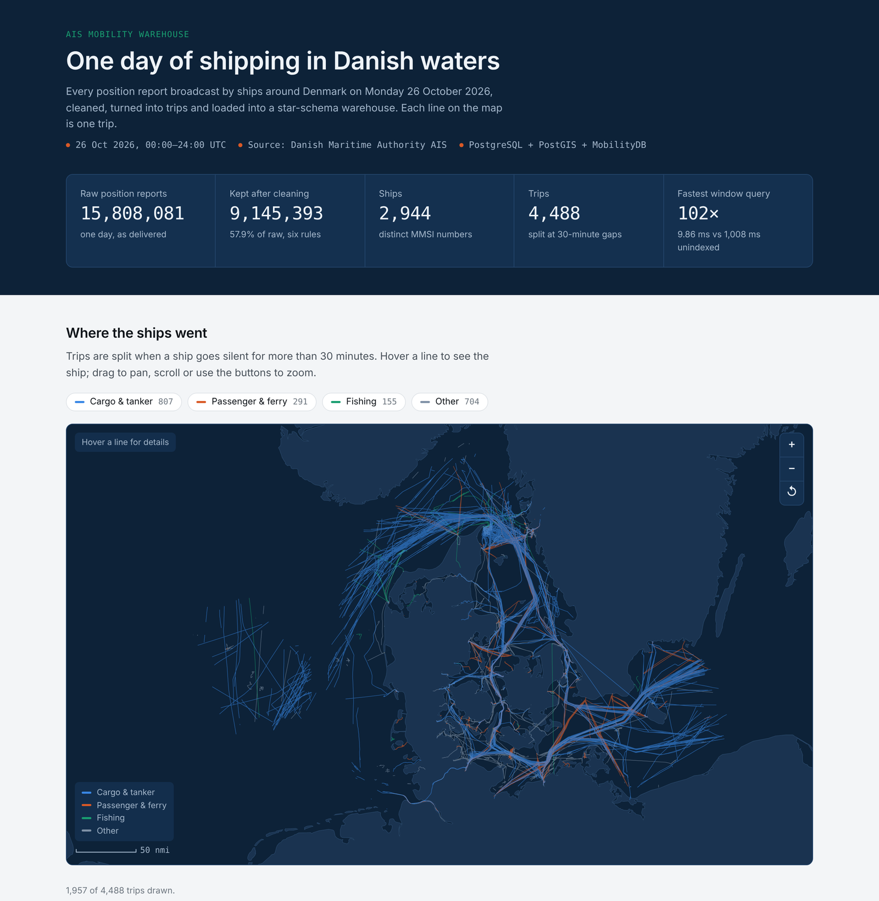
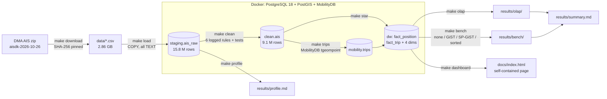

# AIS Mobility Data Warehouse

A reproducible spatiotemporal data warehouse built from one day of real ship-tracking data: **15.8 million AIS position reports** from Danish waters, cleaned with logged rules, turned into ship trips with MobilityDB, modelled as a star schema, queried with OLAP SQL, and used to benchmark spatial indexes.

     

**[Live dashboard](https://alimoiez22.github.io/ais-mobility-warehouse/)** · [Report](docs/report/report.md) · [Decision log](docs/decisions.md) · [Generated summary](results/summary.md)

[](https://alimoiez22.github.io/ais-mobility-warehouse/)

## Key results

All numbers are produced by `make all` from the raw file and stored in [`results/`](results/).

| | Result |
|---|---|
| **Data** | 26 Oct 2026, Danish Maritime Authority: 15,808,081 raw reports, 26 columns, 2.86 GB CSV |
| **RQ1: data quality** | 6 cleaning rules removed 6,662,688 reports (42.1%); 9,145,393 kept. The largest problem by far: **38.4% of raw rows are exact duplicates** |
| **RQ2: OLAP on a star schema** | 2 fact tables (9.1 M positions, 4,488 trips) and 4 dimensions answer all 8 business questions (ROLLUP, CUBE, spatial window, temporal window, proximity, ranking) |
| **RQ3: spatial indexes** | GiST alone made a small-area query only **2.0×** faster, because matching rows were scattered over 38,127 table pages. GiST on a spatially sorted copy read 841 pages and was **102× faster** (1,008 ms → 9.9 ms). For 10-nearest-ship search GiST was 4,500× faster; with SP-GiST the planner chose a full table scan |

## Research questions

- **RQ1:** What data-quality problems exist in raw AIS data, and how many rows does each cleaning rule remove?
- **RQ2:** Can a multidimensional model (MultiDim, Vaisman & Zimányi) answer realistic maritime questions with OLAP queries?
- **RQ3:** How much do spatial indexes (none vs GiST vs SP-GiST) change query latency? Five timed runs after two warm-ups, median and IQR, `EXPLAIN (ANALYZE, BUFFERS)` plans saved.

## Architecture



## Pipeline

| Step | Command | What it does | Output |
|---|---|---|---|
| Setup | `make init` | Start the database container (image pinned by digest), enable PostGIS and MobilityDB | database `ais` |
| Download | `make download` | Fetch one day, verify the SHA-256 in `data.lock.json`, unzip | `data/` (not committed) |
| Load | `make load` | Stream the CSV into an all-TEXT staging table | `results/staging_rowcount.csv` |
| Profile | `make profile` | Count missing values, out-of-range values, duplicates, malformed IDs | `results/profile.md` |
| Clean | `make clean` | Typed copy, then 6 rules in order, each logging rows before and after; row-count tests | `results/cleaning.csv` |
| Trips | `make trips` | Split each ship's track at reporting gaps (10 and 30 min compared) into MobilityDB trips; tests | `results/trips_compare.csv` |
| Star schema | `make star` | Four dimensions, two fact tables, foreign keys, integrity tests | `results/star_counts.csv` |
| OLAP | `make olap` | 8 business questions | `results/olap/`, `results/olap_runtimes.csv` |
| Benchmark | `make bench` | 3 spatial queries × 4 setups, 2 warm-ups + 5 runs, plans saved | `results/bench/` |
| Figures | `make figures` | Charts from the result files | `docs/figures/` |
| Summary | `make summary` | Headline numbers in one file | `results/summary.md` |
| Dashboard | `make dashboard` | Export simplified trip lines, build a self-contained results page | `docs/index.html` |

`make test` reruns every data test against the current database.

## Data model

| Table | Grain | Rows |
|---|---|---|
| `dw.fact_position` | one cleaned position report: one ship at one second | 9,145,393 |
| `dw.fact_trip` | one trip: a ship's continuous movement until a gap of more than 30 minutes | 4,488 |
| `dw.dim_ship` | one vessel (MMSI), attributes = most frequent value over the day | 2,944 |
| `dw.dim_time` | one hour of the day | 24 |
| `dw.dim_cell` | one 0.25° grid cell over 53–59 N, 2–17 E | 1,440 |
| `dw.dim_nav_status` | one navigational status | 13 |

DDL with column comments: [`sql/40_star_schema.sql`](sql/40_star_schema.sql).

## Repository layout

```
├── Makefile                 every pipeline step is one target; `make all` runs them in order
├── docker-compose.yml       PostgreSQL 18 + PostGIS 3.6 + MobilityDB 1.3, image pinned by digest
├── data.lock.json           URL, size and SHA-256 of the source file
├── sql/                     numbered SQL, run in order (10 load, 2x clean, 3x trips, 4x star schema)
│   ├── olap/                the 8 business questions
│   └── tests/               data tests that fail loudly (RAISE EXCEPTION)
├── scripts/                 download, profiling, OLAP runner, summary, dashboard builder
├── benchmarks/              index benchmark runner and plots
├── results/                 every generated number (CSV, Markdown, EXPLAIN plans)
└── docs/
    ├── index.html           the dashboard (GitHub Pages)
    ├── report/report.md     the project report
    ├── decisions.md         decision log with reasons and evidence
    └── figures/             generated charts and the dashboard screenshot
```

## How to reproduce

Requirements: Docker with Compose, GNU Make, Git, [uv](https://docs.astral.sh/uv/). About 15 GB of free disk on the drive that holds Docker's data.

```bash
git clone https://github.com/Alimoiez22/ais-mobility-warehouse.git
cd ais-mobility-warehouse
cp .env.example .env    # PowerShell: Copy-Item .env.example .env
make all                # download → load → profile → clean → trips → star → olap → bench → figures → summary → dashboard
```

A full run takes about 1.5 hours on a laptop, plus the download. Steps can be rerun on their own (`make clean`, `make bench`, ...). Other targets: `make status`, `make psql`, `make logs`, `make down` (stop, keep data), `make destroy` (stop and delete the database).

**Windows notes (Docker Desktop with WSL2).** Two settings were needed on the development laptop (16 GB RAM):

1. Cap the WSL2 virtual machine. Without a cap, Windows stopped the VM during the 2.86 GB load. In `%UserProfile%\.wslconfig`, then `wsl --shutdown`:
   ```ini
   [wsl2]
   memory=4GB
   swap=8GB
   swapfile=D:\\wsl\\swap.vhdx

   [experimental]
   autoMemoryReclaim=dropCache
   ```
2. Keep Docker's disk image on a drive with free space (Docker Desktop → Settings → Resources → Advanced → Disk image location). With the image on a 93%-full system drive, Windows refused disk writes (`I/O error`, NTSTATUS `0xC000009A`) and PostgreSQL crashed mid-run. Moving the image to a second drive fixed it.

## Limitations

- One day from one provider: daily and seasonal patterns may differ.
- Timestamps are treated as UTC (the DMA files do not state a zone per row).
- The spatial dimension is a regular grid, not real sea areas.
- Cleaning rule 6 removes isolated position jumps only. Ships whose positions are wrong for a long stretch are not caught; 5 of 4,488 trips still average more than 50 knots.
- Benchmark times are warm-cache, on one laptop inside Docker's WSL2 VM with 4 GB of memory. Absolute times will differ elsewhere; the relative differences and the page counts are the result.
- Staging and warehouse tables are `UNLOGGED` for load speed, so an unclean database shutdown empties them; `make load` rebuilds them from the source file.

## Data source and attribution

Contains data from the Danish Maritime Authority that is used in accordance with the conditions for the use of Danish public data. The raw data is not redistributed here: `make download` fetches it and verifies it against the checksum in [`data.lock.json`](data.lock.json).

| Day used | Zip | Uncompressed CSV | Columns | Rows loaded |
|---|---|---|---|---|
| 26 Oct 2026 (`aisdk-2026-10-26.zip`) | 567.5 MB | 2.86 GB | 26 | 15,808,081 (3.8 GB staging table) |

The day was the newest full day available on 29 Oct 2026, and a normal 24-hour day (the daylight-saving change was on 25 Oct). The dashboard coastline is Natural Earth 1:10m land (public domain), via the `world-atlas` 2.0.2 package.

## How this project was built

Ali Moiez defined the project and its research questions, set up the environment, ran every pipeline step on his own machine, checked the outputs, and worked through the infrastructure failures during the full runs, including tracing repeated crashes to Docker's virtual disk on a full system drive. Much of the code (SQL, Python scripts, Makefile, Docker setup and the dashboard) was written with an AI assistant (Claude) under his direction, which also proposed the initial design decisions. Every decision is recorded in [`docs/decisions.md`](docs/decisions.md) with its evidence and its review status.

## Citation

If you use this work, please cite it as described in [`CITATION.cff`](CITATION.cff).

## Licence

Code: MIT ([LICENSE](LICENSE)). The DMA data is subject to its own conditions.
