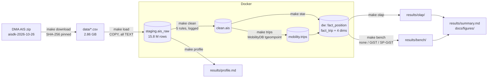

# AIS Mobility Data Warehouse

> Status: pipeline written end to end (M0-M6); first full run, author review of decisions and report (M7) in progress.
> Every number below comes from `results/`, regenerated by `make all`.

A reproducible data warehouse built on one day of real ship-tracking (AIS) data from the Danish Maritime Authority: 15.8 million raw position reports, cleaned, turned into ship trips with MobilityDB, modelled as a star schema, queried with OLAP SQL, and used to benchmark spatial indexes. PostgreSQL, PostGIS and MobilityDB run in Docker.

## Research questions
- **RQ1:** What data-quality problems exist in raw AIS data, and how many rows does each cleaning rule remove?
- **RQ2:** Can a multidimensional model answer realistic maritime questions with OLAP queries?
- **RQ3:** How much do spatial indexes (none vs GiST vs SP-GiST) change query latency?

**Results:** [`results/summary.md`](results/summary.md) (generated), with the figures in `docs/figures/`.

## Architecture



## Pipeline

| Step | Command | What it does | Output |
|---|---|---|---|
| Setup | `make init` | Start PostgreSQL 18 + PostGIS 3.6 + MobilityDB 1.3, enable extensions | database `ais` |
| Download | `make download` | Fetch one day, verify the SHA-256 in `data.lock.json`, unzip | `data/` (not committed) |
| Load | `make load` | Stream the CSV into an all-TEXT staging table | `results/staging_rowcount.csv` |
| Profile | `make profile` | Count missing values, out-of-range values, duplicates, odd IDs | `results/profile.md` |
| Clean (M2) | `make clean` | Typed copy, then 5 rules in order, each logging rows removed; tests | `results/cleaning.csv` |
| Trips (M3) | `make trips` | Split each ship's positions on time gaps (10 and 30 min) into MobilityDB trips; tests | `results/trips_compare.csv` |
| Star (M4) | `make star` | Dimensions and two fact tables, foreign keys, integrity tests | `results/star_counts.csv` |
| OLAP (M5) | `make olap` | 8 business questions (ROLLUP, CUBE, spatial, temporal, proximity) | `results/olap/`, `results/olap_runtimes.csv` |
| Benchmark (M6) | `make bench` | 3 spatial queries x 3 index types, 5 warm runs, EXPLAIN plans | `results/bench/` |
| Figures | `make figures` | Charts from the result files | `docs/figures/` |
| Summary | `make summary` | All headline numbers in one file | `results/summary.md` |

`make test` reruns every data test. Decisions behind each step, with reasons: [`docs/decisions.md`](docs/decisions.md).

## Data model

Grain of the two fact tables:
- **`dw.fact_position`**: one row per cleaned AIS position report, i.e. one ship at one second.
- **`dw.fact_trip`**: one row per trip, i.e. one ship's continuous movement until a reporting gap of more than 30 minutes.

Dimensions: `dim_ship` (vessel), `dim_time` (hour of the day), `dim_cell` (0.25-degree grid over 53-59 N, 2-17 E), `dim_nav_status`. Schema and comments: `sql/40_star_schema.sql`.

## How to reproduce
Requirements: Docker (with Compose), GNU Make, Git, uv. About 15 GB free disk.

**Windows note:** with Docker Desktop's default settings, loading the 2.86 GB CSV restarted Docker's WSL2 virtual machine four times on a 16 GB laptop (the VM was stopped from the Windows side; nothing was logged inside it). Capping the VM fixed it. Put this in `%UserProfile%\.wslconfig`, then run `wsl --shutdown` and restart Docker Desktop:

```ini
[wsl2]
memory=4GB
swap=8GB

[experimental]
autoMemoryReclaim=dropCache
```

```bash
cp .env.example .env    # PowerShell: Copy-Item .env.example .env
make all                # every step, from download to results/summary.md
```

Other targets: `make status`, `make psql` (SQL prompt), `make logs`, `make down` (stop, keep data), `make destroy` (stop and delete data).

The database image is pinned by digest in `docker-compose.yml`, so every run uses the same PostgreSQL, PostGIS and MobilityDB versions.

## Limitations
- One day of data from one provider: patterns (traffic by hour, busiest areas) may not generalise to other days or seasons.
- Timestamps are assumed to be UTC.
- The spatial dimension is a regular grid, not real sea areas.
- Benchmark numbers are warm-cache only, on one laptop inside Docker's WSL2 VM; absolute times will differ elsewhere, relative differences are the result.

## Plan
See [PLAN.md](PLAN.md).

## Data source and attribution
Contains data from the Danish Maritime Authority that is used in accordance with the conditions for the use of Danish public data.

Raw data is not redistributed in this repository. `make download` fetches it and verifies it against the SHA-256 checksum pinned in [`data.lock.json`](data.lock.json).

| Day used | Zip | Uncompressed CSV | Columns | Rows loaded into staging |
|---|---|---|---|---|
| 26 Oct 2026 (`aisdk-2026-10-26.zip`) | 567.5 MB | 2.86 GB | 26 | 15,808,081 (3.8 GB table) |

The day was chosen as the newest full day available on 29 Oct 2026. It is a normal 24-hour day (the Danish daylight-saving change was on 25 Oct). The zip was fetched with a resumable multi-connection downloader because the connection was slow, so the lock file has no server `Last-Modified` value; the checksum identifies the file exactly.

## AI-use note
AI assistance (Claude) was used throughout. Claude wrote most of the code (download, load, profiling, cleaning, trip, star-schema, OLAP and benchmark SQL and scripts, Makefile, Docker setup), explained each step, and diagnosed the Docker Desktop crash from its logs. To get a working end-to-end pipeline quickly, Claude also proposed the initial project decisions (cleaning rules, trip gap, schema, business questions); each is marked "proposed by Claude" in `docs/decisions.md` until the author has reviewed it and accepted or changed it. The author ran every step on his own machine, checked the outputs, owns the final decisions and their reasoning, and writes the interpretation and the report.

## Licence
Code: MIT (see [LICENSE](LICENSE)). The DMA data is subject to its own conditions.
