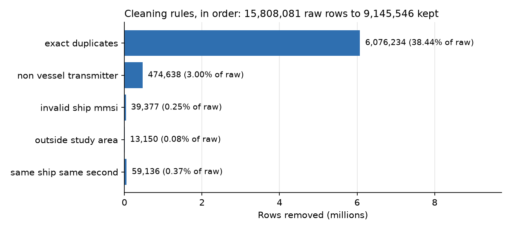
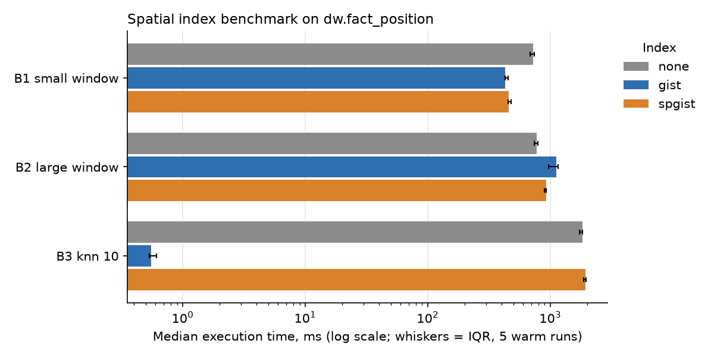

# Results summary

Generated by `scripts/summary.py` from the files in `results/`. Do not edit by hand.

## Load

| Source file | Rows loaded | Staging table size |
|---|---|---|
| aisdk-2026-10-26.csv | 15,808,081 | 3778 MB |

## RQ1: cleaning rules (in the order they run)

| Step | Rule | Rows before | Removed | Rows after | % of raw |
|---|---|---|---|---|---|
| 0 | typed_copy | 15,808,081 | 0 | 15,808,081 | 0.00 |
| 1 | exact_duplicates | 15,808,081 | 6,076,234 | 9,731,847 | 38.44 |
| 2 | non_vessel_transmitter | 9,731,847 | 474,638 | 9,257,209 | 3.00 |
| 3 | invalid_ship_mmsi | 9,257,209 | 39,377 | 9,217,832 | 0.25 |
| 4 | outside_study_area | 9,217,832 | 13,150 | 9,204,682 | 0.08 |
| 5 | same_ship_same_second | 9,204,682 | 59,136 | 9,145,546 | 0.37 |

## Trips: comparing gap values

| Gap (min) | Trips | Ships | Single-report pieces | Median points | Median duration (min) | Median length (km) | Trips avg speed > 50 kn |
|---|---|---|---|---|---|---|---|
| 10 | 10,169 | 2,824 | 4,182 | 10 | 27.0 | 0.02 | 11 |
| 30 | 4,488 | 2,843 | 977 | 423 | 432.7 | 0.77 | 7 |

## Warehouse tables

| Table | Rows |
|---|---|
| dim_ship | 2,944 |
| dim_time | 24 |
| dim_cell | 1,440 |
| dim_nav_status | 13 |
| fact_position | 9,145,546 |
| fact_trip | 4,488 |

## RQ2: OLAP queries

| Query | Business question | Result rows | Execution (ms) |
|---|---|---|---|
| q1_traffic_by_type_and_daypart | Q1: How is AIS traffic (reports and distinct ships) spread over ship types and parts of the day? (ROLLUP) | 126 | 12,457.30 |
| q2_type_by_navstatus_cube | Q2: Which combinations of ship type and navigational status occur, with all subtotals? (CUBE) | 133 | 19,399.50 |
| q3_busiest_cells | Q3: Which 0.25-degree grid cells see the most distinct ships during the day? | 10 | 7,038.80 |
| q4_spatial_window_oresund | Q4: Which ship types used the Øresund strait (55.55-56.10 N, 12.45-12.85 E) during the morning rush 07:00-09:00? (spatial + temporal window) | 18 | 117.90 |
| q5_trips_active_at_noon | Q5: How many trips were under way at some point between 12:00 and 13:00, per ship type, and how long were they? (temporal window on trips) | 25 | 3.80 |
| q6_close_encounters_oresund | Q6: Which pairs of moving ships came within 500 m of each other in the same minute in the Øresund between 07:00 and 09:00? (proximity) | 20 | 533.40 |
| q7_trip_speed_by_type_rollup | Q7: What are the typical trip length and average speed per ship type and transponder class, with subtotals? (ROLLUP on trips) | 25 | 7.60 |
| q8_longest_trips | Q8: Which were the ten longest trips of the day, by which ships, from which cell to which cell? | 10 | 12.80 |

Full results: `results/olap/`.

## RQ3: spatial index benchmark (warm cache, 5 runs)

| Query | Index | Median (ms) | IQR (ms) | Speed-up vs none |
|---|---|---|---|---|
| B1_small_window | none | 726.09 | 54.69 | 1.0 |
| B2_large_window | none | 776.02 | 46.69 | 1.0 |
| B3_knn_10 | none | 1,832.92 | 103.86 | 1.0 |
| B1_small_window | gist | 428.74 | 22.75 | 1.7 |
| B2_large_window | gist | 1,121.06 | 191.34 | 0.7 |
| B3_knn_10 | gist | 0.55 | 0.08 | 3332.6 |
| B1_small_window | spgist | 457.26 | 21.76 | 1.6 |
| B2_large_window | spgist | 922.42 | 31.04 | 0.8 |
| B3_knn_10 | spgist | 1,930.55 | 69.60 | 0.9 |

| Index | Build time (s) | Size |
|---|---|---|
| gist | 14.0 | 362 MB |
| spgist | 42.1 | 416 MB |

Hardware and settings: `results/bench/environment.txt`. Plans: `results/bench/plans/`.
